<!-- ========================================================= -->
<!--                          HERO                             -->
<!-- ========================================================= -->

  <a href="https://github.com/4sTr0J">
    
  </a>


<!-- ========================================================= -->
<!--                        INTRO                              -->
<!-- ========================================================= -->

<table align="center" width="96%">
<tr>
<td valign="top">

<h2>// 0x01_RECON // Defending Networks &amp; Breaking Systems</h2>

I'm a <strong>Cyber Security Enthusiast, Network Defense Analyst &amp; Developer from Sri Lanka</strong> specialized in offensive security reconnaissance, traffic forensics, and developing hardened software architectures.

From solving complex <strong>CTF challenges on TryHackMe</strong> to architecting <strong>containerized banking systems with Java &amp; Docker</strong> and building real-time cryptographic password analyzers, I combine low-level packet inspection with modern secure code practices.

<table>
<tr>
<td><strong>Offensive Sec &amp; Exploitation</strong> Kali Linux · Metasploit · Burp Suite · Hydra · John the Ripper</td>
<td><strong>Reverse Engineering &amp; Scanning</strong> Ghidra · Nessus · Nmap · Hashcat · CVE Analysis</td>
</tr>
<tr>
<td><strong>Network Defense &amp; SOC</strong> Wireshark · Wazuh SIEM · Suricata/Snort · CCNA Routing</td>
<td><strong>Tooling &amp; Sandboxing</strong> Python 3 · Docker · Linux/Bash · Microservices</td>
</tr>
</table>

🛡️ Active CTF player &amp; blue team defensive analyst 
⚡ Building custom security analyzers &amp; automated penetration scripts 
<em>Terminal quote: "There is no patch for human curiosity."</em>

</td>
</tr>
</table>


  

&nbsp;

  


<!-- ========================================================= -->
<!--                   TECHNOLOGY MATRIX                       -->
<!-- ========================================================= -->

  


<!-- ========================================================= -->
<!--                      WHAT I BUILD                         -->
<!-- ========================================================= -->

  


<!-- ========================================================= -->
<!--                     FEATURED WORK                         -->
<!-- ========================================================= -->

<h2 align="center">Security Projects &amp; Repositories</h2>

<table align="center" width="96%">
<tr>
<td width="50%" valign="top">
<h3><a href="https://github.com/4sTr0J/Project-PowerPass">Project-PowerPass</a></h3>
Python · Tkinter · Cryptographic Entropy

GUI-based real-time password strength analyzer with vulnerability detection, NIST-aligned entropy estimation, and cryptographically secure pass generation.

</td>
<td width="50%" valign="top">
<h3><a href="https://github.com/4sTr0J/CIT-24-01-0475">Banking Core Architecture</a></h3>
Java · Docker · Enterprise Isolation

Containerized core banking system engineered with strict transactional consistency and isolated Docker environments for secure accounting.

</td>
</tr>
<tr>
<td width="50%" valign="top">
<h3><a href="https://github.com/4sTr0J/NLP_Group_02">NLP Text Intelligence Engine</a></h3>
Python · NLP · Machine Learning

Natural Language Processing pipeline built for semantic linguistic modeling, text classification, and sentiment intelligence.

</td>
<td width="50%" valign="top">
<h3><a href="https://github.com/4sTr0J/Project-StylePulse">Project StylePulse</a></h3>
JavaScript · Web Security · Frontend UX

Modern interactive web application highlighting responsive design, robust state management, and optimized client-side security.

</td>
</tr>
</table>

<a href="https://github.com/4sTr0J?tab=repositories"><b>Explore all security repositories →</b></a>


<!-- ========================================================= -->
<!--                      OBSERVABILITY                        -->
<!-- ========================================================= -->

<h2 align="center">Threat Observability &amp; Activity</h2>

  
  

  

  

  <a href="https://tryhackme.com/p/4sTr0J">
    
  </a>

  


<!-- ========================================================= -->
<!--                        DEV PETS                           -->
<!-- ========================================================= -->

  


<!-- ========================================================= -->
<!--                        CONNECT                            -->
<!-- ========================================================= -->

  <a href="https://github.com/4sTr0J">
    
  </a>

  
  
  

